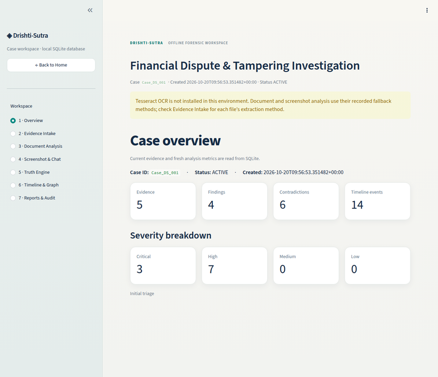
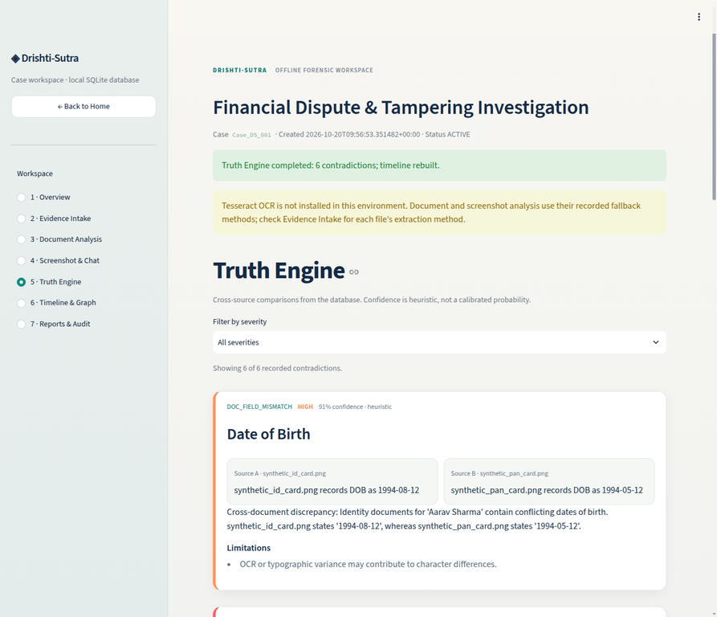
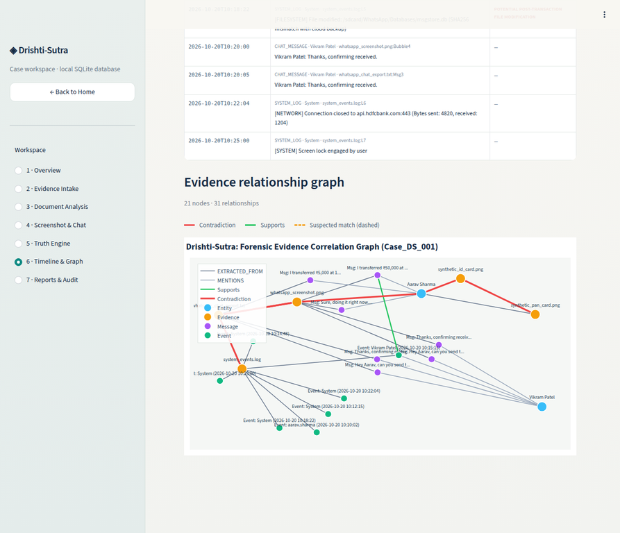
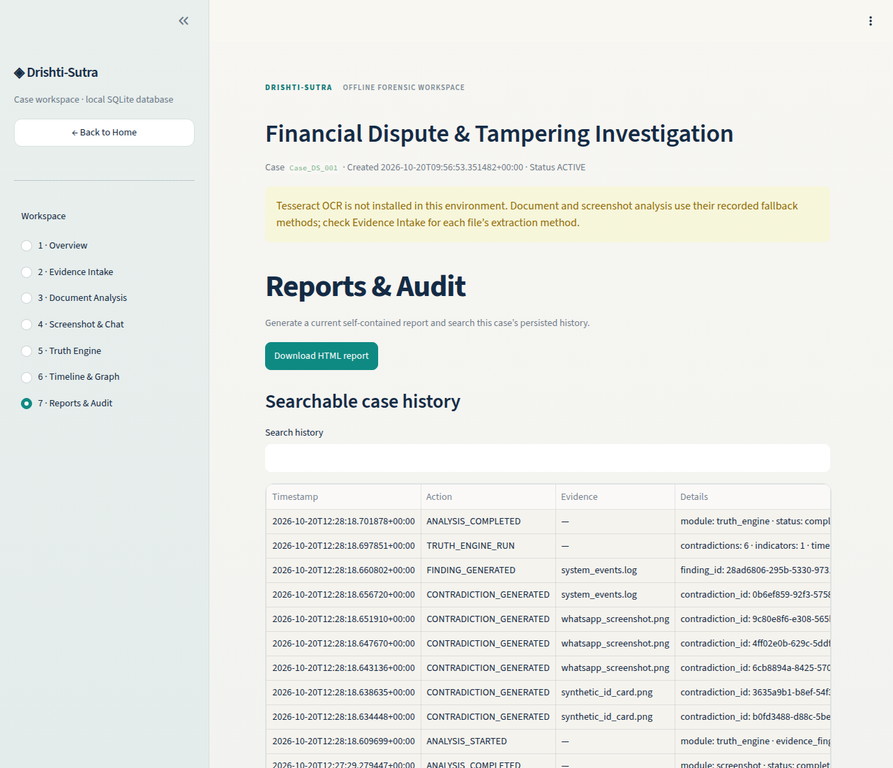
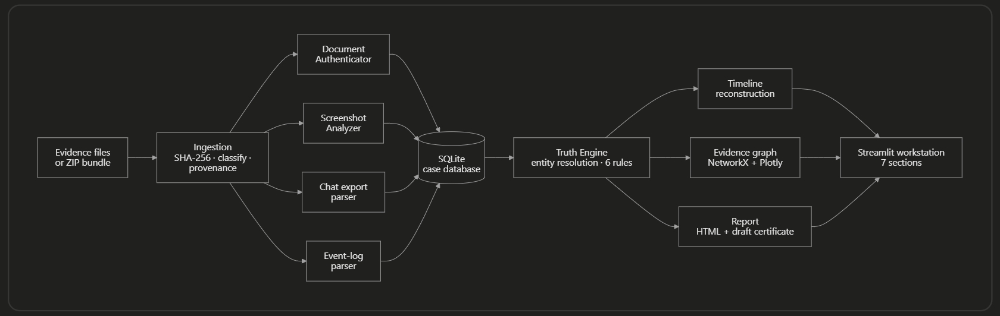

<div align="center">

# 👁️ Drishti-Sutra

### Offline-first digital evidence analysis and cross-source correlation

*Ingest evidence → extract → correlate → find contradictions → rebuild the timeline → export a traceable report.*


</div>

---

## Why this exists

Digital evidence rarely arrives as one clean file. A single dispute can involve identity documents, a chat screenshot, a text export of the same chat, and a system log. The story only breaks down when you **compare them against each other**: a date of birth that differs between two IDs, an amount that reads ₹50,000 in a screenshot and ₹5,000 in the export, a message that appears in one source and not the other.

Doing that by hand is slow and easy to get wrong. **Drishti-Sutra** (Sanskrit: *drishti* "sight", *sutra* "thread") automates the comparison. It runs real analysis on the files you give it, links entities across sources, flags **potential anomalies**, explains each one with its supporting and conflicting sources, and exports a report that traces every statement back to a file and a SHA-256 hash.

> It is an investigative aid, not a verdict engine. Every output is a *potential indicator for human review*, never proof of forgery, fraud or wrongdoing, and the tool never claims official or government verification.

<div align="center">

| Overview | Truth Engine |
|:---:|:---:|
|  |  |
| **Timeline & relationship graph** | **Reports & audit** |
|  |  |

</div>

---

## How it works

Drishti-Sutra is built from **three analysis modules** that sit on a shared foundation (ingestion and a case database) and feed one dashboard and report. Modules 1 and 2 *read* individual pieces of evidence. Module 3 *compares* everything they found.

<div align="center">
    
</div>


### Foundation: ingestion and storage
Evidence can be uploaded as individual files or a ZIP bundle. Each file is hashed with **SHA-256**, classified (identity document, chat screenshot, chat export, system log), registered with its provenance, and recorded in an **audit log**. Original files are preserved, and everything the modules produce is stored in **SQLite** through shared Pydantic models. This is what lets every finding be traced back to a specific file and hash.

### Module 1: Document Authenticator
**Question it answers:** *Is this identity document consistent with itself?*

It cleans the image with OpenCV, extracts text (Tesseract OCR when available), and pulls out fields such as name, date of birth and ID number. It then runs two independent checks:
- **QR vs printed text.** The QR code is decoded (`pyzbar`, with an OpenCV fallback) and its payload is compared with what is printed on the card.
- **Error Level Analysis (ELA).** The image is recompressed and block-level variance is measured, producing an overlay that highlights regions with unusual compression behaviour.

*Output:* structured document records and findings. ELA and QR results are **indicators, never proof**. A failed decode or an unusual compression pattern alone never establishes forgery.

### Module 2: Screenshot and Chat Analysis
**Question it answers:** *What does this conversation say, and does it hold together?*

For **screenshots**, it segments chat bubbles with OpenCV, reads the sender, message text and displayed time of each bubble, and checks whether the visible order matches the timestamps. For **text exports** (WhatsApp format), a parser extracts timestamps, senders, message bodies and monetary amounts such as ₹5,000. An **event-log parser** does the same for system logs, extracting time, actor, transaction details (e.g. `Amount`, `TxnID`, `Payee`) and file events.

*Output:* structured messages and log records, each tagged with its source file and the **extraction method** used, so uncertainty is never hidden.

### Module 3: Truth Engine
**Question it answers:** *Do the different sources agree with each other?*

It takes everything Modules 1 and 2 stored and compares it **across** sources:

1. **Entity resolution.** Names, usernames and IDs are normalised and linked with RapidFuzz. Exact matches are *confirmed*; fuzzy matches are *suspected*.
2. **Contradiction detection.** Six deterministic rules (below) compare documents, screenshots, exports and logs.
3. **Timeline reconstruction.** Messages and log events are merged into one chronological timeline, with anomalies and unusual intervals flagged.
4. **Evidence graph.** A NetworkX/Plotly graph links entities, evidence files, messages and events. Contradictions are drawn in red, supporting links in green, suspected matches dashed.

| Code | What it compares |
|---|---|
| `DOC_FIELD_MISMATCH` | Same resolved person across documents with conflicting DOB or ID fields (formats normalised first) |
| `QR_PRINTED_MISMATCH` | Decoded QR payload vs printed fields on the same document |
| `MESSAGE_TEXT_ALTERED` / `AMOUNT_MISMATCH` | Screenshot vs export messages aligned by sender, time window and fuzzy text, then compared on text and amounts |
| `MESSAGE_ABSENT_IN_EXPORT` | A message in one source missing from the other, **only when the other source's time coverage makes the comparison fair** |
| `ORDER_INVERSION` | Visual order vs timestamps, using full datetimes (dates inferred from the export and flagged), midnight rollover handled |
| `LOG_COMM_CONFLICT` | System-log transaction records vs amounts and claims in messages, stated neutrally without deciding which source is right |

A missing record is **never** treated as proof of deletion. Every contradiction carries its source references, observed facts for both sides, a derived result, and a list of limitations (for example *"timezone unknown; sources assumed on the same clock"*).

### Putting it together: one example
Suppose a chat screenshot shows a transfer of ₹50,000 and the text export of the same chat says ₹5,000.

1. **Module 2** extracts the screenshot message and the export message separately, each with its source and method.
2. **Module 3** aligns the two (same sender, same minute, similar text), sees the amounts differ, and raises `AMOUNT_MISMATCH`.
3. It then checks the **system log**, finds a transaction for ₹50,000.00 seconds earlier, and raises `LOG_COMM_CONFLICT`, stating that the log agrees with the screenshot and differs from the export **without concluding which one was altered**.
4. The finding appears on the timeline and as a red edge in the graph, and is written into the report with both sources, the hashes of both files, and its limitations.

No single module could see that. The value comes from comparing sources against each other.

---

## Highlights

- **Real processing, no scripted results.** Findings are computed from the ingested files and stored in SQLite. Nothing shown in the UI is hardcoded.
- **Forensic traceability.** SHA-256 at ingestion, provenance for every evidence item, an audit log, and an explicit label for *how* each item was extracted.
- **Graceful degradation.** Missing Tesseract, missing `pyzbar`, malformed ZIPs or one unreadable file never crash the run. Failures and skips are recorded, not hidden.
- **Deterministic and re-runnable.** Stable IDs mean re-running a case updates results instead of duplicating them.
- **Optional local LLM.** A summary can be rephrased by a local model (`DRISHTI_LLM_URL`), with automatic fallback to a deterministic template. The LLM can never add or change findings.
- **Self-contained HTML report** with hashes, findings, explanations, limitations and a **draft Section 63(4)(c) BSA certificate** template.

---

## The demo case: *Case DS-001, Digital Communication Discrepancy*

The repository ships a fully synthetic case (`sample_data/Case_DS_001/`, no real identities or private communications) with deliberate inconsistencies. The pipeline **discovers** them at runtime. The expected results are never read as answers.

| Planted inconsistency | Detected as | Severity* |
|---|---|:---:|
| Date of birth differs between two ID documents (`1994-05-12` vs `1994-08-12`) | `DOC_FIELD_MISMATCH` | High |
| Printed DOB on the ID card differs from its decoded QR payload | `QR_PRINTED_MISMATCH` | Critical |
| Screenshot shows ₹50,000, text export shows ₹5,000 for the same message | `AMOUNT_MISMATCH` | Critical |
| A message visible in the screenshot is absent from the export, inside the export's covered time span | `MESSAGE_ABSENT_IN_EXPORT` | High |
| Screenshot shows a 10:16 AM message above a 10:15 AM message | `ORDER_INVERSION` | High |
| System-log transaction amount agrees with the screenshot and differs from the export | `LOG_COMM_CONFLICT` | High |

Plus an **indicator**: a file-modification warning in the system log shortly after the transaction, and an ELA compression-variance indicator on the ID card image.

<sub>*Severity and confidence are heuristic scores from documented rules in [`src/config.py`](src/config.py). They are not calibrated probabilities.</sub>

---

## Quick start

**Requirements:** Python 3.10+ (developed on 3.12). Tesseract OCR is optional.

```bash
git clone https://github.com/<your-username>/Drishti-Sutra.git
cd Drishti-Sutra

python3 -m venv .venv
source .venv/bin/activate          # Windows: .venv\Scripts\activate
python -m pip install -r requirements.txt

streamlit run app.py
```

### Five-minute walkthrough

1. Start the app and keep the default case ID `Case_DS_001`.
2. Click **Load sample evidence (synthetic Case DS-001)**, or upload your own files or a ZIP bundle.
3. Click **Run Analysis**.
4. Walk the sections: **Overview → Evidence Intake → Document Analysis → Screenshot & Chat → Truth Engine → Timeline & Graph → Reports & Audit**.
5. In **Reports & Audit**, download the self-contained HTML report.

### Command line

```bash
# Run the full pipeline headlessly and print the findings
python scripts/run_pipeline.py --case-dir sample_data/Case_DS_001 \
       --db data/drishti_sutra.db --graph-out data/graph.html

# Regenerate the synthetic demo case
python scripts/generate_demo_case.py
```

### Optional local LLM summary

```bash
export DRISHTI_LLM_URL=http://localhost:11434/api/generate   # e.g. an Ollama endpoint
```

If the variable is unset or the endpoint fails (3 s timeout), the app uses a deterministic template summary. A badge in the UI shows which one was used.

---

## Extraction modes (please read)

Drishti-Sutra records **how** each item was extracted and shows it in Evidence Intake, so you always know what a finding is based on.

| Method label | Meaning |
|---|---|
| `ocr` | Text read from pixels with Tesseract (requires the Tesseract binary on `PATH`) |
| `embedded_metadata` | Fallback used when Tesseract is unavailable: text and layout data carried in the **synthetic sample images** generated by `scripts/generate_demo_case.py` |
| `regex_export` | Text chat export parsed with pattern rules |
| `log_parser` | System log parsed line by line, unparseable lines recorded as skipped |

The bundled demo images carry their own metadata so the demo runs fully offline on any machine. Real-world screenshots and scans need the OCR path, and OCR accuracy on stylised or low-quality images is a known limitation (see below).

---

## Project structure

```
Drishti-Sutra/
├── app.py                        # Streamlit workstation (7 sections)
├── requirements.txt
├── .streamlit/config.toml        # theme and server settings
├── src/
│   ├── models.py                 # Pydantic contracts shared by every module
│   ├── database.py               # SQLite layer (cases, evidence, findings, audit, ...)
│   ├── ingestion.py              # file/ZIP intake, SHA-256, classification
│   ├── pipeline.py               # run_case_pipeline(): one entry point for the whole flow
│   ├── truth_engine.py           # Module 3: entity resolution + contradiction rules + summary
│   ├── timeline.py               # Module 3: unified chronological reconstruction
│   ├── graph_builder.py          # Module 3: NetworkX graph + Plotly figure
│   ├── reporting.py              # self-contained HTML report + draft certificate
│   ├── config.py                 # every threshold and scoring weight in one place
│   └── analyzers/
│       ├── document_analyzer.py  # Module 1: OCR, QR, ELA, field extraction
│       ├── screenshot_analyzer.py    # Module 2: bubble segmentation, order checks
│       ├── chat_export_parser.py     # Module 2: WhatsApp export parser
│       └── event_log_parser.py       # Module 2: system-log parser
├── scripts/                      # CLI pipeline, demo-case generator, analyzer demo
├── sample_data/Case_DS_001/      # synthetic evidence + manifest (used by tests only)
└── tests/                        # analyzers, truth engine, reporting, workflow
```

---

## Testing

```bash
python -m pytest tests -q
```

The suite covers the analyzers, the full Truth Engine pipeline on `Case_DS_001`, ID determinism and idempotent re-runs, the LLM fallback, reporting output, and an isolated upload workflow.

> **Note:** the suite is written against the offline fallback path. On a machine with Tesseract installed, extraction differs (OCR reads real pixels) and a few assertions that expect the demo's exact values may not match. Run the tests without Tesseract on `PATH` for the reference result.

---

## The report and the Section 63(4)(c) certificate draft

The exported HTML report is self-contained (no external requests) and includes evidence references, full SHA-256 hashes, findings with explanations and confidence, a timeline, limitations, and an audit trail. It also contains a **draft certificate template** following the structure of the Schedule to the Bharatiya Sakshya Adhiniyam, 2023 (Section 63(4)).

The draft pre-fills only values the tool can compute (file hashes, algorithm, date and time).

---

## Design principles

1. **No fabricated results.** Every number, finding, node and event traces back to an ingested file.
2. **Neutral language.** "Potential anomaly" and "indicator", never "forged" or "fraudulent".
3. **Traceability.** Findings link to source files, locations and extraction methods, and statements are labelled *observed*, *derived* or *hypothesis*.
4. **Explainable scoring.** Confidence comes from documented rules and constants, and is labelled heuristic.
5. **Fail soft.** Missing tools and bad files are recorded and skipped; they do not take the app down.
6. **Offline by default.** The core pipeline needs no internet and no cloud service.

---

## Limitations

- **Prototype on synthetic data.** It has not been validated on real casework or against ground-truth forensic datasets.
- **OCR quality varies.** On the OCR path, extraction from low-quality or stylised images can miss fields or messages, which reduces what the Truth Engine can compare. Skipped comparisons are recorded rather than guessed.
- **ELA is only an indicator.** Compression variance can come from many benign causes. A failed QR decode, low OCR confidence or an unusual layout never establishes forgery by itself.
- **Timezones are unknown.** No source states one, so cross-source time comparisons assume a shared clock and say so.
- **Entity matching is fuzzy.** Links below the exact-match threshold are marked *suspected*.
- **Scores are heuristic.** They are rule-based indicators, not statistical probabilities.
- **PDF input is not yet supported** in the document analyzer.
- **Not a legal tool.** It does not establish admissibility, authenticity or guilt.

---

## Tech stack

Python · Streamlit · OpenCV · Pillow · Tesseract (`pytesseract`, optional) · pyzbar / OpenCV QR · RapidFuzz · NetworkX · Plotly · Pydantic v2 · SQLite · Jinja2 · pytest

---

## Responsible use

Drishti-Sutra is intended for education, research and demonstration with **synthetic or lawfully obtained data**. Do not use its output as the sole basis for any accusation or legal decision. Findings are leads for human review.

## License

Released under the MIT License. See `LICENSE`.
